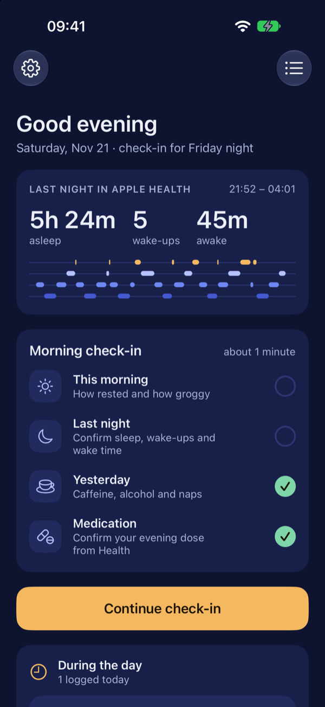
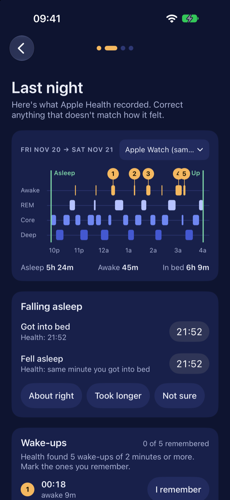
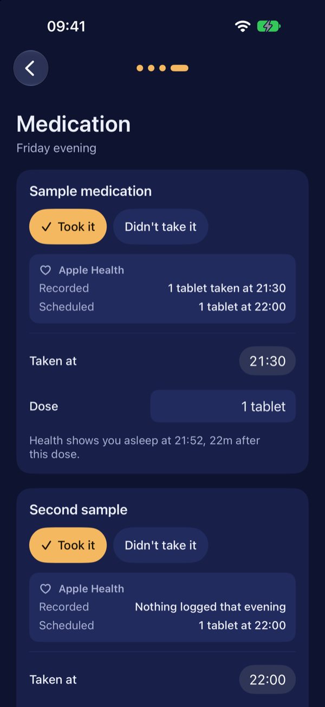

# Sleep Diary

An iPhone app for a short morning sleep check-in that sits alongside the sleep Apple Watch or AutoSleep records in Apple Health, with a PDF/CSV export to bring to a doctor.

  
  
  

- Morning check-in: how rested and groggy, last night from Health to confirm or correct, caffeine, alcohol and naps, and medications.
- Daytime symptoms, rated on Health's four levels.
- Caffeine, alcohol, symptoms and (optionally) naps are written to Health. Corrections to the night stay in the app.

## Run it

1. Open `Sleep Diary.xcodeproj` in Xcode 26 or later.
2. In Signing & Capabilities, choose your team. Change the bundle ID if Xcode says it's taken.
3. Run on an iPhone with Developer Mode on. With a free Apple ID, trust the developer in Settings › General › VPN & Device Management, and reinstall every 7 days.
4. Allow Health access, then add your medications in the app's Settings › Apple Health.

The Simulator has no sleep data, so debug builds there show a sample night.

Design: `docs/design.md`. Notes for Claude Code: `CLAUDE.md`.
